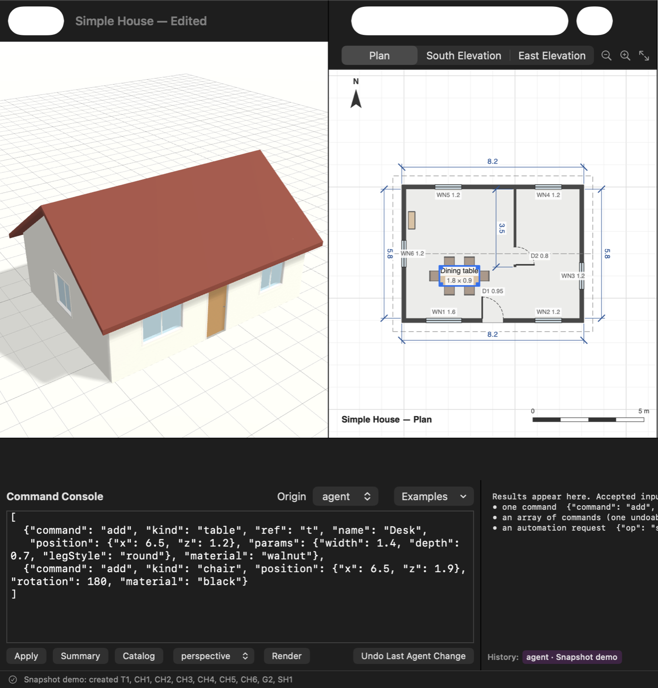

# draw4me

A native macOS app (Swift, SwiftUI + SceneKit) for designing houses, furniture and other
objects in 3D and 2D. It covers the same ground as SketchUp, but it's built to be much easier:
you place parametric objects (walls, doors, windows, roofs, tables, chairs and so on) and edit
their dimensions in metres. You don't draw faces and push/pull them.

It's built **AI-first**. Every edit is a typed JSON command that goes through a single command
layer. That's true for toolbar clicks, inspector edits, drags, the Command Console and the CLI.
A future AI agent will use exactly the same path. **This version contains no AI integration:**
no API calls or keys, no MCP server, no sockets and no network. See
[docs/AI-INTEGRATION.md](docs/AI-INTEGRATION.md) for the seams that are in place and the
decision that's still open.



## Requirements

- macOS 14 or later, Apple Silicon or Intel with Metal
- Swift 6 toolchain. The Command Line Tools are enough; Xcode is **not** required.

## Build and run

```bash
scripts/build-app.sh            # builds build/Draw4Me.app (release) with Info.plist, icon, document type
open build/Draw4Me.app
```

To run it straight from SwiftPM during development (it still gets a normal window and Dock icon):

```bash
swift run Draw4Me
```

Tests:

```bash
scripts/test.sh                 # = swift test, plus the flag CLT-only machines need (see below)
```

With Xcode installed, plain `swift test` works. With only the Command Line Tools, SwiftPM
silently skips swift-testing unless you pass the framework path
(`swift test -Xswiftc -F/Library/Developer/CommandLineTools/Library/Developer/Frameworks`).
`scripts/test.sh` does that for you.

Release build: `swift build -c release`.

## Using the app

- **Toolbar:** quick-add wall, door, window, floor, table, chair and box. The **+** menu has every
  object kind plus "Insert Dining Set / Simple House". New objects go where the 3D view is
  looking. A door or window goes into the selected wall, or the first wall if none is selected.
- **File menu:** New, New from Template (Simple House, Dining Set), Open/Save/Save As
  (`.draw4me`, JSON). Export covers the 3D view as PNG (same camera as on screen), the 2D drawing
  as PNG, and the model as USDZ or OBJ+MTL.
- **3D view:**
  - Drag empty space to orbit. Right-drag, ⌥-drag or ⇧-scroll to pan. Scroll or pinch to zoom.
  - Click to select. ⇧/⌘-click adds to or removes from the selection.
  - **Drag a selected object** to move it on the ground plane. It snaps to 5 cm; hold ⌥ to move
    freely. Doors and windows slide along their wall.
  - ⌫ deletes, F frames everything, Esc deselects.
- **2D view:** Plan, South Elevation and East Elevation, drawn in a SwiftUI Canvas.
  - The plan cuts the walls at 1 m. It shows door swings, window glazing, dimension lines on
    every wall, labels for furniture and openings, the roof outline (dashed), a north arrow and
    a scale bar.
  - Click to select. Drag a selected object in the plan to move it. Drag empty space to pan.
    Scroll or pinch to zoom.
- **View modes:** 3D, 2D, or Split (the default).
- **Outliner (left):** the object tree. Groups contain their members, and walls contain their
  doors and windows.
- **Inspector (right):** name, position, rotation, every parameter with its units, and the
  material (preset or any colour).
- **Edit menu:** Undo/Redo (⌘Z / ⇧⌘Z, labelled with what they undo), Duplicate (⌘D), Delete
  (⌘⌫), Group (⌘G), Ungroup (⇧⌘G).
- **Developer → Command Console (⇧⌘K):** see below.

### Coordinates and units

Everything is in metres and degrees. +Y is up, +X is east, +Z is south, so north is up on the
plan. Rotation is yaw, counter-clockwise seen from above.

How `position` works for each kind:

- **Wall:** the start of the wall line, which runs `length` along its local +X. You can also
  give `from` and `to` instead.
- **Slab:** the centre of its top surface.
- **Door or window:** no position of its own. It sits in a host wall at `offset`, measured from
  the wall's start.
- **Everything else:** the centre of the footprint, at its base.

## Command Console

Open it with **Developer → Command Console**. Paste a command, an array of commands (applied as
**one** undoable transaction), or an automation request, then press **Apply** (⌘↩). The
**Origin** picker (user/script/agent) is recorded in the history, and **Undo Last Agent Change**
undoes only an agent-made step. **Render** shows what an agent would "see".

```json
{"command": "add", "kind": "table", "name": "Dining table",
 "position": {"x": 2.5, "z": 4}, "params": {"width": 1.8, "legStyle": "round"}, "material": "oak"}
```

```json
[
  {"command": "add", "kind": "wall", "ref": "s", "from": {"x": 0, "z": 4}, "to": {"x": 5, "z": 4}},
  {"command": "add", "kind": "door", "host": "@s", "params": {"offset": 1.2}},
  {"command": "add", "kind": "window", "host": "@s", "params": {"offset": 3.5, "width": 1.4}}
]
```

`ref` gives a new object a batch-local name, and later commands in the same batch refer to it as
`@name`.

More examples:

```json
{"command": "update", "id": "T1", "params": {"height": 0.74}, "material": "walnut"}
{"command": "move", "ids": ["T1", "CH1"], "by": {"x": 0.5}}
{"command": "rotate", "ids": ["CH1"], "degrees": 90}
{"command": "resize", "id": "W1", "dimensions": {"length": 6}}
{"command": "array", "ids": ["CH1"], "count": 4, "spacing": {"x": 0.6}}
{"command": "loadTemplate", "template": "dining_set", "replace": false, "offset": {"x": 2, "z": 3}}
{"op": "summary"}
{"op": "render", "render": {"view": "plan", "width": 1200, "height": 800}}
{"op": "undo", "origin": "agent"}
```

The **Examples** menu has a valid example for every command. **Catalog** prints the full
reference, generated from the same table the decoder validates against. Errors name the command
and the problem, for example:

> Door 'D3' (width 0.9 m at offset 0.1 m) doesn't fit in wall 'W1' (length 8.2 m). The offset
> must be between 0.45 and 7.75.

Unknown fields are rejected, so a typo like `"lenght"` fails instead of being silently ignored.

**Commands:** `newDocument`, `loadTemplate`, `add`, `update`, `move`, `rotate`, `resize`,
`setMaterial`, `group`, `ungroup`, `delete`, `duplicate`, `array`, `transaction`.

**Object kinds:** `wall`, `slab`, `door`, `window`, `roof` (gable/hip/flat), `box`, `cylinder`,
`table` (square/round/pedestal/trestle legs), `chair`, `shelf`, `group`.

**Materials:** `white_paint`, `plaster`, `concrete`, `brick`, `oak`, `walnut`, `pine`, `glass`,
`steel`, `black`, `tile`, `fabric_grey`, `roof_tile`, `slate`, `grass`, or any `#RRGGBB` colour.

## CLI

`draw4me-cli` is headless: it applies commands to a document and renders PNGs. It uses no
network.

```bash
swift build -c release
CLI=$(swift build -c release --show-bin-path)/draw4me-cli
$CLI --commands Examples/house-and-table.json --save house.draw4me \
     --render house.png --view perspective --render plan.png --view plan
$CLI --doc house.draw4me --request Examples/agent-request.json --in-place   # same JSON a future bridge would send
$CLI --doc house.draw4me --summary          # compact text a model can read
$CLI --catalog                              # JSON schema of every command (for generating tool definitions)
```

Run `$CLI --help` for all options. A copy of the CLI also ships inside `Draw4Me.app/Contents/MacOS/`.

## Architecture

```
Sources/
  Draw4MeCore/        Foundation only, no UI. The model and the only way to change it.
    Model.swift       SceneDocument (versioned JSON), SceneObject, ObjectKind + parameter specs, materials
    Commands.swift    Command enum (Codable, {"command": ...}), payloads, CommandError, origins
    Catalog.swift     CommandCatalog: one table → decoder validation, JSON schema, text help
    Engine.swift      Applies commands to a document value (validation, refs, cascades)
    Editor.swift      DocumentEditor: atomic batches, origin-tagged undo/redo history, dry runs
    Geometry.swift    Parametric objects → faces (shared by 3D, 2D, OBJ, bounds, hit testing)
    Summary.swift     Deterministic scene summary (text + JSON) with relationships
    Templates.swift   Simple House, Dining Set, written as plain command lists
    Export.swift      OBJ/MTL export
  Draw4MeRender/      SceneKit + CoreGraphics
    SceneBuilder      Document → SCNScene (one node per object id), lighting, grid, orbit camera
    Drafting          Plan/elevation drawing (used by both the app's Canvas and PNG export), hit testing
    Renderer          Headless render(document, view, size) → PNG; works with no window
  Draw4MeAutomation/  AutomationService protocol, in-process implementation, JSON request/response
                      endpoint (where a future MCP bridge, file watcher or CLI transport plugs in)
  Draw4Me/            SwiftUI app: AppModel, 3D viewport, 2D view, inspector, outliner, console
  draw4me-cli/        Headless CLI over the same automation service
Tests/                swift-testing: commands, undo/redo, validation, JSON round trips, catalog
                      completeness, templates, geometry, summary, headless rendering, automation JSON
```

**Data flow:** UI gesture, console JSON or CLI → `Command` → `DocumentEditor.apply` (validate,
then commit, then record history with its origin) → `onChange` → views rebuild from the new
document. The UI never mutates the document directly. Live drag previews are either transient
node offsets (3D) or an `editor.dryRun` (2D), and the actual change is one `move` command on
mouse-up.

**Developer aid:** `DRAW4ME_SNAPSHOT=/tmp/w.png build/Draw4Me.app/Contents/MacOS/Draw4Me` makes
the app save an image of its window and quit. Adding `DRAW4ME_SNAPSHOT_COMMANDS=cmds.json`
applies those commands first, as the agent. This was used to verify the UI without screen
recording permission.

## Known limitations (v0.1)

- **Walls:** they're straight segments and corners simply overlap. There's no automatic corner
  joining, no rooms or areas, and no curved walls.
- **Doors and windows:** these are rectangles in a single wall. The 3D door is drawn closed, and
  windows have a single mullion.
- **Rotation:** yaw only, with no tilt. Groups are flat containers with no group-local
  coordinates.
- **Snapping:** the 3D move handles snap to a 5 cm grid only. There's no inference snapping to
  other objects' edges (SketchUp-style), and no on-screen arrow gizmo; you drag the object
  itself.
- **Elevations:** these use a painter's algorithm. That's fine for typical scenes, but complex
  overlaps can draw in the wrong order.
- **Multiple windows:** it's a single-window app, with one document at a time.

## Roadmap

1. **Decide the AI direction** ([docs/AI-INTEGRATION.md](docs/AI-INTEGRATION.md)), then add the
   chosen transport on top of `AutomationEndpoint`.
2. **Modelling:**
   - Wall joins and rooms, with floor area and labels
   - Multi-storey levels, stairs
   - Openings in slabs
   - Snapping and inference
   - Measure tool, and a draggable dimension edit in the plan
3. **Furniture and object library:** beds, sofas, cabinets, kitchen runs, and parametric
   shelving variants.
4. **Drawing output:** PDF sheets with title blocks, more elevations and sections, and choice of
   scale.
5. **Rendering:** textures and materials library, nicer lighting, and a USDZ AR Quick Look
   preview.
6. **Multiple documents:** `DocumentGroup` multi-window, and autosave/versions.
